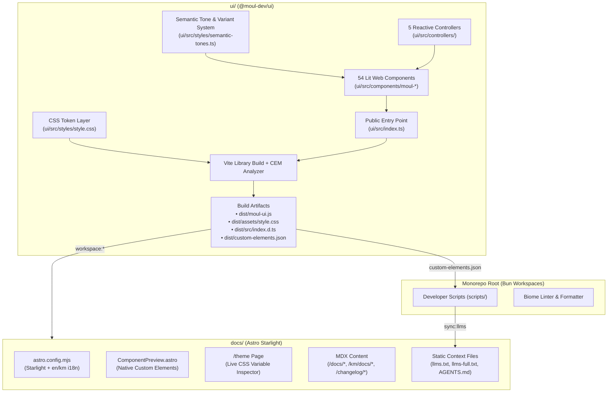

# Technical Specification: `@moul-dev/ui` Lit Web Components & Astro Starlight Rebuild

**Status:** Draft / Ready for Implementation  
**Target Version:** CalVer (`YYYY.M.D`)  
**Source Requirements:** [requirements.md](./requirements.md)

---

## 1. Executive Summary & Architecture Overview

`@moul-dev/ui` is transitioning from a React + React Aria + StyleX + Recharts component library and a Waku + Fumadocs documentation site to a **zero-React, standards-first Web Components architecture** built on **Lit 3**, **Shadow DOM**, a **CSS Design Token Layer (`light-dark()` + `oklch()`)**, **native browser APIs** (`<dialog>`, Popover API, CSS Anchor Positioning, `ElementInternals`), **d3-scale / d3-shape / motion**, and an **Astro Starlight** documentation site.

### 1.1 High-Level Monorepo Architecture



### 1.2 Target Directory Structure

```text
.
├── package.json                          # Workspace root scripts & Biome config
├── biome.json                            # Formatter & linter rules
├── requirements.md                       # Requirements specification
├── design.md                             # This technical specification
├── scripts/
│   ├── dev.ts                            # Concurrent Vite + Astro dev runner
│   ├── gen-component.ts                  # Lit component + test + MDX scaffolder
│   ├── sync-llms.ts                      # CEM -> llms.txt / llms-full.txt validator & generator
│   ├── bump-version.ts                   # UTC CalVer (YYYY.M.D / YYYY.M.D.N) bumper
│   └── verify-no-react.ts                # Disallowed dependency build guard
├── ui/
│   ├── package.json                      # Zero-React Lit package manifest
│   ├── vite.config.ts                    # Vite library mode + CSS emission + React ban check
│   ├── custom-elements-manifest.config.mjs # CEM schema v2 analyzer config
│   ├── tsconfig.json
│   └── src/
│       ├── index.ts                      # Single public entry point
│       ├── test-setup.ts                 # happy-dom + ElementInternals/Popover/Dialog shims
│       ├── styles/
│       │   ├── style.css                 # :root CSS Token Layer (light-dark + oklch)
│       │   ├── reset.styles.ts           # Shared Shadow DOM box-sizing & focus-visible reset
│       │   └── semantic-tones.ts         # 5 Tones × 5 Variants CSSResult generator
│       ├── utils/
│       │   ├── define-element.ts         # Idempotent customElements.define wrapper
│       │   ├── warn-missing-label.ts     # Dev-mode accessibility warning helper
│       │   ├── focus-trap.ts             # Keyboard focus trap & focus restoration utility
│       │   ├── motion.ts                 # motion.dev presets, FLIP helper & reduced-motion guard
│       │   └── icons.ts                  # Zero-dependency Lit svg`` internal UI icons
│       ├── controllers/
│       │   ├── index.ts                  # Barrel export for all 5 controllers
│       │   ├── press.controller.ts
│       │   ├── layout-indicator.controller.ts
│       │   ├── overlay-presence.controller.ts
│       │   ├── number-spring.controller.ts
│       │   └── form-internals.controller.ts
│       └── components/
│           └── <ComponentName>/
│               ├── <ComponentName>.ts
│               ├── <ComponentName>.styles.ts
│               ├── <ComponentName>.test.ts
│               └── index.ts
└── docs/
    ├── package.json                      # Astro + @astrojs/starlight manifest
    ├── astro.config.mjs                  # Starlight configuration & i18n routing
    ├── public/
    │   ├── AGENTS.md
    │   ├── llms.txt
    │   └── llms-full.txt
    └── src/
        ├── content.config.ts             # Astro Content Collections schema
        ├── components/
        │   ├── ComponentPreview.astro    # Native Web Component live preview wrapper
        │   └── ThemeInspector.astro      # Interactive brand token sliders
        ├── styles/
        │   └── global.css                # Imports @moul-dev/ui/style.css + Kantumruy Pro font
        ├── pages/
        │   └── theme.astro               # /theme interactive token playground
        └── content/
            └── docs/                     # English (root) & Khmer (/km/) MDX files
```

---

## 2. Package & Dependency Specification (Requirement 1 & 16)

### 2.1 Disallowed Dependency Policy

Both `ui/package.json` and `docs/package.json` are strictly prohibited from containing any React or legacy styling dependencies. A build-time guard (`scripts/verify-no-react.ts`, also invoked inside `ui/vite.config.ts` and `docs/astro.config.mjs`) inspects `dependencies`, `devDependencies`, and `peerDependencies` and exits with status code `1` listing any offending package if found:

- **Banned in `ui/package.json`:** `react`, `react-dom`, `react-aria`, `react-aria-components`, `react-stately`, `@stylexjs/stylex`, `@stylexjs/unplugin`, `@vitejs/plugin-react`, `recharts`, `input-otp`, `waku`, `@lit/react`, `@phosphor-icons/react`, `@testing-library/react`, `@types/react`, `@types/react-dom`, or any package matching `/^react-/`.
- **Banned in `docs/package.json`:** `react`, `react-dom`, `react-aria-components`, `waku`, `fumadocs-core`, `fumadocs-mdx`, `fumadocs-ui`, `react-server-dom-webpack`, `lucide-react`, `@tanstack/react-pacer`, `@tanstack/react-query`, `@tanstack/react-store`, `@tanstack/react-table`, `@tanstack/react-virtual`, `@types/react`, `@types/react-dom`, `@stylexjs/stylex`, `@astrojs/react`, or any package matching `/^react-/`.

### 2.2 `ui/package.json` Specification

```json
{
  "name": "@moul-dev/ui",
  "version": "2026.10.16",
  "description": "Accessible, standards-first Web Components library built with Lit, Shadow DOM, and native CSS tokens",
  "license": "MIT",
  "type": "module",
  "main": "./dist/moul-ui.js",
  "module": "./dist/moul-ui.js",
  "types": "./dist/src/index.d.ts",
  "customElements": "./dist/custom-elements.json",
  "sideEffects": [
    "./dist/moul-ui.js",
    "./dist/assets/style.css"
  ],
  "files": [
    "dist",
    "README.md",
    "LICENSE"
  ],
  "exports": {
    ".": {
      "types": "./dist/src/index.d.ts",
      "import": "./dist/moul-ui.js",
      "default": "./dist/moul-ui.js"
    },
    "./style.css": {
      "style": "./dist/assets/style.css",
      "default": "./dist/assets/style.css"
    }
  },
  "scripts": {
    "dev": "vite",
    "build": "bun ../scripts/verify-no-react.ts ui && tsc -b && vite build && cem analyze --config custom-elements-manifest.config.mjs",
    "build:watch": "vite build --watch",
    "lint": "biome check",
    "format": "biome format --write",
    "gen:component": "bun ../scripts/gen-component.ts",
    "preview": "vite preview",
    "test": "vitest run"
  },
  "dependencies": {
    "@lit-labs/virtualizer": "^2.1.0",
    "@lit/context": "^1.1.3",
    "d3-scale": "^4.0.2",
    "d3-shape": "^3.2.0",
    "lit": "^3.2.1",
    "motion": "^13.4.1"
  },
  "devDependencies": {
    "@biomejs/biome": "^2.5.0",
    "@custom-elements-manifest/analyzer": "^0.10.4",
    "@open-wc/testing-helpers": "^2.2.0",
    "@types/d3-scale": "^4.0.8",
    "@types/d3-shape": "^3.1.6",
    "@types/node": "^24.12.3",
    "fast-check": "^3.23.2",
    "glob": "^11.0.0",
    "happy-dom": "^16.8.1",
    "typescript": "~6.0.2",
    "vite": "^8.0.12",
    "vite-plugin-dts": "^5.0.2",
    "vitest": "^2.1.8"
  }
}
```

> **Note on Export Contract (Requirement 16):** Only `.` and `./style.css` exist in `exports`. Legacy `./react`, `./tokens`, `./tokens.stylex`, `./theme.css`, and `./style` subpaths are removed so module resolvers deterministically reject them with `ERR_PACKAGE_PATH_NOT_EXPORTED`.

### 2.3 `docs/package.json` Specification

```json
{
  "name": "docs",
  "private": true,
  "version": "2026.10.16",
  "type": "module",
  "scripts": {
    "dev": "astro dev",
    "build": "bun ../scripts/verify-no-react.ts docs && astro build",
    "preview": "astro preview",
    "types:check": "astro check && tsc --noEmit",
    "lint": "biome check",
    "format": "biome format --write"
  },
  "dependencies": {
    "@astrojs/starlight": "^0.32.0",
    "@moul-dev/ui": "workspace:*",
    "@phosphor-icons/web": "^2.1.1",
    "astro": "^5.5.0",
    "sharp": "^0.33.5"
  },
  "devDependencies": {
    "@biomejs/biome": "^2.5.0",
    "@types/node": "^25.9.3",
    "typescript": "^6.0.3"
  }
}
```

---

## 3. Lit Custom Element Architecture (Requirement 2)

### 3.1 Element Naming & Registration (`defineElement`)

Every component is authored as a `LitElement` subclass with an open Shadow Root (`mode: 'open'`, the LitElement default) and a `moul-` tag prefix matching `/^moul-[a-z0-9-]+$/`.

To satisfy **Requirement 2.9** and **Requirement 16.5** (duplicate imports must never throw or overwrite existing registrations, and must emit a `console.warn`), all components register via `ui/src/utils/define-element.ts`:

```ts
// ui/src/utils/define-element.ts
export function defineElement(
  tagName: string,
  ctor: CustomElementConstructor,
): void {
  if (typeof customElements === 'undefined') return
  const existing = customElements.get(tagName)
  if (existing) {
    console.warn(
      `[@moul-dev/ui] Custom element "${tagName}" is already registered. Skipping duplicate registration.`,
    )
    return
  }
  customElements.define(tagName, ctor)
}
```

### 3.2 Reactive Property & Attribute Reflection Rules

1. **Reflected Primitives:** Only `String`, `Number`, and `Boolean` properties with defined default values set `reflect: true` when state needs to be queryable in CSS (`:host([variant="solid"])`, `:host([is-disabled])`) or DOM inspection.
2. **Attribute Naming:** Multi-word camelCase properties map to kebab-case HTML attributes (e.g., `@property({ type: Boolean, reflect: true, attribute: 'is-disabled' }) accessor isDisabled = false`).
3. **Complex Data Properties:** Array and object properties (e.g., `data` on charts/tables, `logs` on `moul-logs-viewer`) are declared with `@property({ attribute: false })` except where JSON attribute parsing is explicitly supported (such as `moul-table`'s `data` property which uses a safe JSON converter fallback).
4. **Standardized Custom Events:** Components dispatch standard `CustomEvent<T>` instances with `{ bubbles: true, composed: true }` so events cross Shadow DOM boundaries naturally.

### 3.3 Dev-Mode Accessible Label Validation (`warnMissingLabel`)

To satisfy **Requirement 2.8** and **Requirement 8.3**, interactive elements that lack visible text (such as `moul-button[is-icon]`, `moul-checkbox` without label/slot, `moul-modal` without header/aria-label) call `warnMissingLabel` inside `updated()`:

```ts
// ui/src/utils/warn-missing-label.ts
export function warnMissingLabel(
  host: HTMLElement,
  description: string,
  hasVisibleLabel = false,
): void {
  if (process.env.NODE_ENV === 'production') return
  const hasAriaLabel =
    Boolean(host.getAttribute('aria-label')?.trim()) ||
    Boolean(host.getAttribute('aria-labelledby')?.trim())
  if (!hasAriaLabel && !hasVisibleLabel) {
    console.warn(
      `[@moul-dev/ui] <${host.tagName.toLowerCase()}> is missing an accessible label (${description}). Provide an "aria-label" or "aria-labelledby" attribute.`,
    )
  }
}
```

### 3.4 Internal Icons Strategy

Internal component affordances (close `×` icon, select chevron, search magnifier, clear button, external link arrow, alert status icons, spinner ring, calendar navigation arrows) are implemented in `ui/src/utils/icons.ts` as pure Lit `svg\`...\`` template functions with `aria-hidden="true"` and `focusable="false"`. This guarantees zero external icon runtime dependencies in `@moul-dev/ui`.

---

## 4. CSS Design Token Layer (Requirement 3)

### 4.1 Token Architecture (`ui/src/styles/style.css`)

The stylesheet `ui/src/styles/style.css` is emitted to `dist/assets/style.css` and exported as `@moul-dev/ui/style.css`. Because CSS custom properties inherit across Shadow DOM boundaries, defining all tokens on `:root` makes them immediately available inside every `<moul-*>` Shadow Root without JavaScript runtime injection.

Following modern CSS best practices:
- `:root` sets `color-scheme: light dark;` so `light-dark()` resolves automatically to the user's OS preference.
- `[data-theme="light"] { color-scheme: light; }` and `[data-theme="dark"], .dark { color-scheme: dark; }` allow explicit subtree or document-wide theme switching.
- Color tokens remain unregistered custom properties holding `light-dark(oklch(...), oklch(...))` expressions so they evaluate dynamically in the `color-scheme` context where they are consumed.

### 4.2 Complete Token Mapping Table (`tokens.stylex.ts` → `style.css`)

| Category | CSS Custom Property Names | Value / Formula Specification |
| :--- | :--- | :--- |
| **Brand Hooks** | `--brand-hue`<br>`--brand-chroma-multiplier`<br>`--brand-font-family`<br>`--brand-font-scale`<br>`--brand-density-factor`<br>`--brand-radius-factor` | `250`<br>`1`<br>`inherit`<br>`1`<br>`1`<br>`1` |
| **Neutral Scale** | `--color-neutral-50` … `--color-neutral-900` | 10 steps (`50, 100, 200, 300, 400, 500, 600, 700, 800, 900`) preserving exact `light-dark(oklch(L 0 0), oklch(L 0 0))` values from `tokens.stylex.ts` |
| **Primary Scale** | `--color-primary-50` … `--color-primary-900` | 10 steps using `calc(C * var(--brand-chroma-multiplier, 1)) var(--brand-hue, 250)` |
| **Error Scale** | `--color-error-300` … `--color-error-700` | 5 steps (`300–700`), hue `27` |
| **Warning Scale** | `--color-warning-300` … `--color-warning-700` | 5 steps (`300–700`), hue `85` |
| **Success Scale** | `--color-success-300` … `--color-success-700` | 5 steps (`300–700`), hue `145` |
| **Semantic Aliases** | `--color-bg`<br>`--color-bg-subtle`<br>`--color-bg-elevated`<br>`--color-fg`<br>`--color-fg-subtle`<br>`--color-fg-on-primary`<br>`--color-border`<br>`--color-border-subtle`<br>`--color-border-focus`<br>`--color-bg-glass`<br>`--color-border-glass`<br>`--color-shadow`<br>`--color-overlay` | Exact `light-dark(oklch(...), oklch(...))` values from `tokens.stylex.ts` |
| **Alert / Status** | `--color-alert-bg-{variant}`<br>`--color-alert-border-{variant}`<br>`--color-alert-hover-{variant}`<br>`--color-alert-active-{variant}` | For `{variant}` in `info`, `accent`, `success`, `warning`, `error` (20 tokens total) |
| **Typography** | `--font-size-{step}`<br>`--line-height-{step}`<br>`--font-weight-{normal\|medium\|semibold\|bold}`<br>`--font-family-base` | `{step}` in `xs, sm, md, lg, xl, xxl, 3xl, 4xl` scaled by `var(--brand-font-scale, 1)`; weights `400, 500, 600, 700`; `var(--brand-font-family, inherit)` |
| **Spacing** | `--spacing-1` … `--spacing-8` | `calc((N * 0.25rem) * var(--brand-density-factor, 1))` (4px base steps) |
| **Border Radius** | `--radius-none`, `--radius-sm`, `--radius-md`, `--radius-lg`, `--radius-full` | `0`, `0.375rem`, `0.75rem`, `1.25rem` (scaled by `--brand-radius-factor`), `9999px` |
| **Shadows** | `--shadow-sm`<br>`--shadow-md`<br>`--shadow-lg` | `0 1px 2px 0 var(--color-shadow)`<br>`0 4px 6px -1px var(--color-shadow), 0 2px 4px -2px var(--color-shadow)`<br>`0 10px 15px -3px var(--color-shadow), 0 4px 6px -4px var(--color-shadow)` |
| **Z-Index** | `--z-base`, `--z-dropdown`, `--z-modal`, `--z-tooltip`, `--z-toast` | `0`, `1000`, `1300`, `1500`, `1700` |
| **Chart Colors** | `--color-chart-1` … `--color-chart-8` | 8 `light-dark(oklch(...), oklch(...))` series colors |

---

## 5. Semantic Tone and Visual Variant System (Requirement 4)

### 5.1 Type Definitions & Normalization (`ui/src/styles/semantic-tones.ts`)

```ts
import { type CSSResultGroup, css } from 'lit'

export const SEMANTIC_TONES = [
  'primary',
  'accent',
  'success',
  'warning',
  'error',
] as const
export type SemanticTone = (typeof SEMANTIC_TONES)[number]

export const VISUAL_VARIANTS = [
  'solid',
  'flat',
  'shadow',
  'bordered',
  'glass',
] as const
export type VisualVariant = (typeof VISUAL_VARIANTS)[number]

export function normalizeTone(
  value: unknown,
  fallback: SemanticTone = 'primary',
): SemanticTone {
  return SEMANTIC_TONES.includes(value as SemanticTone)
    ? (value as SemanticTone)
    : fallback
}

export function normalizeVariant(
  value: unknown,
  fallback: VisualVariant = 'flat',
): VisualVariant {
  return VISUAL_VARIANTS.includes(value as VisualVariant)
    ? (value as VisualVariant)
    : fallback
}
```

### 5.2 25-Combination CSS Matrix

`semanticToneStyles` defines tone-scoped CSS custom properties (`--_tone-solid-bg`, `--_tone-solid-fg`, `--_tone-soft-bg`, `--_tone-soft-fg`, `--_tone-border`) for each of the 5 `SemanticTone` values (`[data-tone="..."]` or `:host([tone="..."])`) and combines them with the 5 `VisualVariant` treatments (`solid`, `flat`, `shadow`, `bordered`, `glass`), producing all 25 tone × variant combinations cleanly:

- **`solid`**: `background-color: var(--_tone-solid-bg); color: var(--_tone-solid-fg); border: 1px solid transparent;`
- **`flat`**: `background-color: var(--_tone-soft-bg); color: var(--_tone-soft-fg); border: 1px solid transparent;`
- **`bordered`**: `background-color: transparent; color: var(--_tone-soft-fg); border: 1px solid var(--_tone-border);`
- **`shadow`**: `background-color: var(--_tone-solid-bg); color: var(--_tone-solid-fg); box-shadow: var(--shadow-md); border: 1px solid transparent;`
- **`glass`**:
  - Base (fallback when `backdrop-filter` is unsupported): `background-color: var(--color-bg-glass); border: 1px solid var(--color-border-glass); color: var(--_tone-soft-fg);`
  - Progressive enhancement:
    ```css
    @supports (backdrop-filter: blur(12px)) or (-webkit-backdrop-filter: blur(12px)) {
      :host([variant="glass"]), [data-variant="glass"] {
        background-color: var(--color-bg-glass);
        border: 1px solid var(--color-border-glass);
        -webkit-backdrop-filter: blur(12px);
        backdrop-filter: blur(12px);
      }
    }
    ```
- **Invalid Attribute Handling (Requirement 4.8):** Components apply `data-tone=${normalizeTone(this.tone, defaultTone)}` and `data-variant=${normalizeVariant(this.variant, defaultVariant)}` on their inner surface wrapper (or normalize `:host` selectors) so unrecognized `tone` or `variant` attributes automatically render with the component's default tone and variant.

---

## 6. Reactive Controllers Specification (Requirement 5)

All five controllers implement `ReactiveController` from `lit` and are exported from `ui/src/controllers/index.ts`.

### 6.1 `PressController` (`ui/src/controllers/press.controller.ts`)

- **State Properties:**
  - `isPressed: boolean = false`
  - `isHovered: boolean = false`
  - `isFocusVisible: boolean = false`
- **Options:**
  - `scaleOnPress?: boolean | number` (default `0.97` when enabled on interactive elements like `moul-button`, `moul-toggle-button`, `moul-card[is-interactive]`, `moul-tag`)
  - `hoverLift?: boolean | number` (default `-2` px vertical lift when enabled on `moul-card[is-interactive]`)
  - `target?: () => HTMLElement | null` (optional inner Shadow DOM element to animate)
- **Behavior:**
  - On `hostConnected()`: attaches listeners on `this.host` for `pointerdown`, `pointerup`, `pointercancel`, `pointerenter`, `pointerleave`, `focusin`, `focusout`, `keydown`, and `keyup` (or delegates to `press()` and `hover()` from `motion` when tactile motion is configured).
  - Records whether the host should sync `aria-pressed`: `true` if `host.getAttribute('type') === 'button'`, `host.getAttribute('type') === 'checkbox'`, or `host.hasAttribute('aria-pressed')` on first `hostConnected()`.
  - Updates state properties on pointer/keyboard interaction, calls `this.host.setAttribute('aria-pressed', String(this.isPressed))` when `shouldSyncAriaPressed` is active, and calls `this.host.requestUpdate()`.
  - When `scaleOnPress` is enabled and `prefers-reduced-motion: no-preference`, runs `animate(el, { scale: 0.97 }, SPRING_SNAPPY)` on press start and springs back (`scale: 1`) on release/cancel.
  - Respects `is-disabled` / `disabled` on the host (suppresses press/hover activation and motion when disabled).

### 6.2 `LayoutIndicatorController` (`ui/src/controllers/layout-indicator.controller.ts`)

- **State Properties:**
  - `breakpoint: 'xs' | 'sm' | 'md' | 'lg' | 'xl' = 'md'`
  - `width: number = 0`
  - `height: number = 0`
- **Breakpoint Mapping (Requirement 5.3):**
  - `0 <= width <= 479` → `'xs'`
  - `480 <= width <= 767` → `'sm'`
  - `768 <= width <= 1023` → `'md'`
  - `1024 <= width <= 1279` → `'lg'`
  - `width >= 1280` → `'xl'`
- **Behavior:**
  - Observes `this.host` via `ResizeObserver` in `hostConnected()` and disconnects in `hostDisconnected()`.
  - Calls `this.host.requestUpdate()` whenever `breakpoint` (or observed dimensions when `observeDimensions: true` is passed by `ChartContainer`) changes.

### 6.3 `OverlayPresenceController` (`ui/src/controllers/overlay-presence.controller.ts`)

- **State Properties:**
  - `isOpen: boolean = false`
  - `isMounted: boolean = false`
- **Preset Modes:** `'modal' | 'popover' | 'tooltip' | 'drawer-left' | 'drawer-right' | 'drawer-top' | 'drawer-bottom' | 'toast'`
- **Behavior:**
  - Exposes `setOpen(nextOpen: boolean, targetElement?: Element | null): Promise<void>`.
  - When `isOpen` transitions to `true`: sets `isMounted = true`, calls `this.host.requestUpdate()`, promotes the native `<dialog>` or `[popover]` to the top layer, and runs a preset-specific entrance animation via `animate()` from `motion`:
    - `'modal'`: `{ opacity: [0, 1], scale: [0.95, 1], y: [8, 0] }` with `SPRING_GENTLE`
    - `'popover'` / `'tooltip'`: placement-aware micro-slide (`4px` offset toward anchor) + `{ opacity: [0, 1], scale: [0.96, 1] }` with `SPRING_SNAPPY`
    - `'drawer-*'`: axis slide from edge (`x: ['100%', '0%']`, `['-100%', '0%']`, or `y: ['100%', '0%']`, `['-100%', '0%']`) with `IOS_SHEET_CURVE` (`[0.32, 0.72, 0, 1]`, `0.28s`)
    - `'toast'`: `{ opacity: [0, 1], y: [14, 0], scale: [0.95, 1] }` with `SPRING_GENTLE`
  - When `isOpen` transitions to `false`: calls `this.host.requestUpdate()`, awaits the exit animation via `motion` (`duration: 0.15s`–`0.22s`), and only then invokes `dialog.close()` or `popover.hidePopover()` and sets `isMounted = false` so exit animations are never clipped by premature top-layer removal.

### 6.4 `NumberSpringController` (`ui/src/controllers/number-spring.controller.ts`)

- **State Properties:**
  - `targetValue: number = 0`
  - `displayValue: number = 0`
- **Behavior (Requirement 5.6):**
  - Clamps incoming target values to `[-999_999_999, 999_999_999]`.
  - Uses `motion`'s spring animation engine (`animate(this.displayValue, clampedTarget, { type: 'spring', stiffness: 260, damping: 28, onUpdate: (v) => ... })`) to step `displayValue` toward `targetValue` on each animation frame, calling `this.host.requestUpdate()` on each frame until `Math.abs(displayValue - targetValue) <= 0.5`, at which point `displayValue` snaps to `targetValue` and stops the loop.
  - Cleans up active animation playback in `hostDisconnected()`.

### 6.5 `FormInternalsController` (`ui/src/controllers/form-internals.controller.ts`)

- **State Properties:**
  - `internals: ElementInternals | null = null`
- **Host Requirement:** Every host class using `FormInternalsController` declares `static formAssociated = true`.
- **Behavior (Requirements 5.7, 5.8, 5.9, 6.7, 9.2, 9.12):**
  - In `hostConnected()`:
    - Checks `typeof this.host.attachInternals === 'function'`.
    - If unavailable, logs `console.warn('[@moul-dev/ui] ElementInternals is not supported in this environment.')`, sets `this.internals = null`, and returns without throwing.
    - Otherwise attaches internals once (`this.internals ??= this.host.attachInternals()`).
    - **Detached Form Warning (Requirement 9.12):** If the host has a `name` attribute (or `options.requireFormConnection` is set) and `this.internals.form === null` after connection, emits `console.warn('[@moul-dev/ui] Form-associated element <...> is not connected to a <form>.')`.
  - `setValue(value: string | File | FormData | null)`:
    - Synchronously invokes `this.internals?.setFormValue(value)` before the next browser repaint (Requirement 6.7).
  - `setValidity(flags: ValidityStateFlags, message?: string, anchor?: HTMLElement)`:
    - Truncates `message` to at most `200` characters (`message?.slice(0, 200)`).
    - Calls `this.internals?.setValidity(flags, truncatedMessage, anchor)` and `this.internals?.reportValidity()`.

### 6.6 `motion.dev` Subtle Animation Architecture (`ui/src/utils/motion.ts`)

All runtime animations use the vanilla DOM exports from `motion` (`import { animate, spring, stagger, press, hover } from 'motion'`) — never `motion/react`.

```ts
// ui/src/utils/motion.ts
import {
  type AnimationOptions,
  type AnimationPlaybackControls,
  animate,
  type DOMKeyframesDefinition,
  stagger,
} from 'motion'

export const SPRING_SNAPPY: AnimationOptions = {
  type: 'spring',
  stiffness: 500,
  damping: 35,
  mass: 0.8,
}

export const SPRING_GENTLE: AnimationOptions = {
  type: 'spring',
  stiffness: 320,
  damping: 28,
  mass: 1,
}

export const IOS_SHEET_CURVE = [0.32, 0.72, 0, 1] as const

export const CHART_EASE = [0.22, 1, 0.36, 1] as const

export function prefersReducedMotion(): boolean {
  return (
    typeof window !== 'undefined' &&
    typeof window.matchMedia === 'function' &&
    window.matchMedia('(prefers-reduced-motion: reduce)').matches
  )
}

/**
 * Runs a subtle motion.dev animation on one or more elements/SVG nodes,
 * automatically collapsing duration to 0 when `prefers-reduced-motion: reduce` is active.
 */
export function subtleAnimate(
  target: Element | Element[] | NodeListOf<Element>,
  keyframes: DOMKeyframesDefinition,
  options: AnimationOptions = SPRING_GENTLE,
): AnimationPlaybackControls {
  if (prefersReducedMotion()) {
    return animate(target, keyframes, { duration: 0 })
  }
  return animate(target, keyframes, options)
}

/**
 * Animates a shared active indicator pill/underline between two elements using FLIP deltas
 * (replaces React's `layoutId` in `moul-tabs`, `moul-toggle-button-group`, and `moul-sidebar`).
 */
export function animateActiveIndicator(
  indicator: HTMLElement,
  previousRect: DOMRect | null,
  nextRect: DOMRect,
): AnimationPlaybackControls | null {
  if (!previousRect || prefersReducedMotion()) return null
  const dx = previousRect.left - nextRect.left
  const dy = previousRect.top - nextRect.top
  const scaleX = previousRect.width / Math.max(nextRect.width, 1)
  const scaleY = previousRect.height / Math.max(nextRect.height, 1)
  return animate(
    indicator,
    {
      x: [dx, 0],
      y: [dy, 0],
      scaleX: [scaleX, 1],
      scaleY: [scaleY, 1],
    },
    SPRING_SNAPPY,
  )
}

export { stagger }
```

#### Summary of Subtle `motion.dev` Animations Across Component Categories

| Category | Components | Subtle `motion.dev` Animation Behavior |
| :--- | :--- | :--- |
| **Actions & Toggles** | `moul-button`, `moul-toggle-button`, `moul-toggle-button-group` | • **Tactile Press:** `scale: 0.97` on pointer/key press, springing back to `1` via `SPRING_SNAPPY`.<br>• **Pending State:** Spinner icon fades and scales in (`scale: [0.75, 1], opacity: [0, 1]`).<br>• **Toggle Group Active Pill:** Shared background indicator glides between toggle buttons via `animateActiveIndicator` (`SPRING_SNAPPY`). |
| **Inputs & Forms** | `moul-checkbox`, `moul-radio-group`, `moul-switch`, `moul-slider`, `moul-select`, `moul-combobox`, `moul-input-otp`, `moul-calendar`, `moul-text-field` (+ `number`, `search`, `textarea`) | • **Checkbox & Radio:** SVG checkmark draws (`pathLength: [0, 1]`) and control pops (`scale: [0.9, 1]`); radio inner dot springs in (`scale: [0, 1]`).<br>• **Switch:** Thumb translates horizontally (`x`) with `SPRING_SNAPPY` and subtly stretches (`scaleX: 1.08`) while pressed.<br>• **Select / ComboBox / DatePicker:** Dropdown opens via `OverlayPresenceController` (`opacity: [0, 1], y: [-4, 0], scale: [0.98, 1]`); chevron rotates `180deg`.<br>• **Calendar:** Month grid slides/crossfades (`x: [dir * 12, 0], opacity: [0, 1]`) on month change.<br>• **InputOTP:** Filled slot pulses (`scale: [0.95, 1.03, 1]`); invalid code triggers horizontal error shake (`x: [0, -6, 6, -4, 4, 0]`).<br>• **Field Errors & Clear Button:** Validation error message slides in (`y: [-4, 0], opacity: [0, 1]`); search clear button pops (`scale: [0.8, 1]`). |
| **Overlays & Navigation** | `moul-modal`, `moul-alert-dialog`, `moul-drawer`, `moul-popover`, `moul-tooltip`, `moul-command-palette`, `moul-tabs`, `moul-pagination` | • **Modal / AlertDialog / CommandPalette:** Spring scale + fade entrance (`scale: [0.95, 1], y: [8, 0], opacity: [0, 1]`) and smooth `150ms` exit before `dialog.close()`.<br>• **Drawer:** Edge slide (`IOS_SHEET_CURVE`, `280ms` enter / `220ms` exit) + interactive pointer drag-to-dismiss with snap-back spring.<br>• **Popover & Tooltip:** Directional `4px` micro-slide + scale (`0.96 -> 1`).<br>• **Tabs:** Active underline/pill glides across tabs via `animateActiveIndicator` (`SPRING_SNAPPY`); active `moul-tab-panel` crossfades (`opacity: [0, 1], y: [4, 0]`, `160ms`). |
| **Surfaces & Feedback** | `moul-alert`, `moul-card`, `moul-progress-bar`, `moul-tag`, `moul-toast`, `moul-empty-state`, `moul-table` | • **Alert:** Entrance fade (`y: [-6, 0], opacity: [0, 1]`) and dismiss collapse (`opacity: [1, 0], scale: [1, 0.96], height: [h, '0px']`).<br>• **Interactive Card:** Hover elevation lift (`y: -2` via `SPRING_GENTLE`) and tactile press (`scale: 0.985`).<br>• **ProgressBar:** Determinate fill bar springs smoothly to new width (`SPRING_GENTLE`).<br>• **Tag:** Removal scales down and fades (`scale: [1, 0.85], opacity: [1, 0]`, `140ms`) before firing `remove`.<br>• **Toast:** Stacked entry slide-in (`y: [14, 0], scale: [0.95, 1], opacity: [0, 1]`) and smooth exit.<br>• **EmptyState:** Staggered entrance (`stagger(0.05)`) of icon, title, description, and actions. |
| **Charts & Analytics** | `moul-line-chart`, `moul-area-chart`, `moul-bar-chart`, `moul-doughnut-chart`, `moul-top-list`, `moul-stat`, `moul-percentage-*`, `moul-chart-tooltip` | • **Line / Area / Bar / Doughnut:** SVG path/shape transitions (`200ms–500ms`, default `350ms` with `CHART_EASE`) + `stagger(0.025)` on bars and slices.<br>• **TopList:** Bar width fill + staggered row fade-in (`stagger(0.03)`).<br>• **Stat:** Spring number ticker via `NumberSpringController`.<br>• **PercentageBar / Circle:** Spring fill width / SVG arc `stroke-dashoffset` transition.<br>• **ChartTooltip:** Smooth spring coordinate tracking + `OverlayPresenceController` fade. |
| **Composite Blocks** | `moul-sidebar`, `moul-logs-viewer` | • **Sidebar:** Active item pill glides with `animateActiveIndicator` (`SPRING_SNAPPY`), group chevron rotates smoothly (`rotate: [0, -90]`), and mobile/collapsed chrome transitions with `IOS_SHEET_CURVE`.<br>• **LogsViewer:** Newly filtered or selected log rows fade in smoothly (`opacity: [0, 1]`). |

---

## 7. Native Browser API Integration & Fallbacks (Requirement 6)

### 7.1 Popover API & CSS Anchor Positioning

Used by: `moul-popover`, `moul-tooltip`, `moul-select`, `moul-combobox`, `moul-chart-tooltip`.

1. **Feature Detection & Fallback (Requirement 6.9):**
   ```ts
   export function supportsNativePopoverAndAnchor(): boolean {
     const hasPopover =
       typeof HTMLElement !== 'undefined' &&
       'popover' in HTMLElement.prototype
     const hasAnchor =
       typeof CSS !== 'undefined' &&
       typeof CSS.supports === 'function' &&
       CSS.supports('anchor-name', '--moul-anchor')
     return hasPopover && hasAnchor
   }
   ```
   - When `supportsNativePopoverAndAnchor()` is `false`, opening the overlay emits a `console.warn` message once per element instance and computes fixed coordinates from the trigger's `getBoundingClientRect()` (`position: fixed; top: ...px; left: ...px; z-index: var(--z-dropdown)`).
2. **Anchor Positioning CSS Rules:**
   - Trigger gets `anchor-name: --moul-trigger;` (or dynamic per-instance style `--_anchor-name`).
   - Overlay gets `position-anchor: --moul-trigger; position: fixed; position-area: block-end; position-try-fallbacks: flip-block, flip-inline;` inside `@supports (anchor-name: --moul-anchor) { [popover] { inset: auto; margin: unset; } }`.
   - Open state selector uses `:where(:popover-open, .\:popover-open, [data-fallback-open])` for compatibility.
3. **Keyboard Focus Trap (Requirement 6.8):**
   - When a Popover-based overlay (`moul-popover`, `moul-select`, `moul-combobox`) opens via keyboard interaction (`Enter`, `Space`, `ArrowDown`, `ArrowUp`), `FocusTrapController` / `trapFocus()` moves focus into the first interactive item inside the overlay and wraps `Tab` / `Shift+Tab` inside the overlay until dismissed.

### 7.2 Native `<dialog>` API

Used by: `moul-modal`, `moul-alert-dialog`, `moul-drawer`, `moul-command-palette`.

1. **Safe `showModal()` Invocation (Requirement 6.10):**
   ```ts
   export function safeShowModal(
     dialog: HTMLDialogElement | null,
     focusRoot?: HTMLElement,
   ): boolean {
     if (!dialog) return false
     try {
       if (!dialog.open) {
         dialog.showModal()
       }
     } catch (err) {
       console.warn(
         '[@moul-dev/ui] Failed to call dialog.showModal() (element may be disconnected):',
         err,
       )
       return false
     }
     focusFirstElement(focusRoot ?? dialog)
     return true
   }
   ```
2. **Focus Management (Requirements 6.3, 6.4, 10.2, 10.3):**
   - Stores `this.previousActiveElement = document.activeElement as HTMLElement | null` prior to opening.
   - Within `<100ms` of `dialog.showModal()` (synchronously via `queueMicrotask` / `requestAnimationFrame`), focuses the first focusable descendant (`button, [href], input, select, textarea, [tabindex]:not([tabindex="-1"])`, piercing slotted children).
   - Traps `Tab` and `Shift+Tab` within the dialog's focusable boundary.
   - On `close()` or `Escape` (`cancel` event on `<dialog>`), awaits the `OverlayPresenceController` exit animation via `motion`, calls `dialog.close()`, restores focus to `this.previousActiveElement?.focus()`, and dispatches `openchange` with `{ detail: { isOpen: false } }`.

---

## 8. Complete 54-Component Specification (Requirements 7–12)

The 54 public components are organized across six categories. Every component is exported from `ui/src/index.ts` and registered in `HTMLElementTagNameMap`.

### 8.1 Category 1: Charts & Data Visualization (7 Components + 2 Helpers — Requirement 7)

All chart components use `d3-scale` (`scaleLinear`, `scaleBand`, `scalePoint`, `scaleTime`) and `d3-shape` (`line`, `area`, `pie`, `arc`, `curveMonotoneX`), style series with `--color-chart-1` through `--color-chart-8`, animate SVG path/geometry updates with `motion` (`200ms–500ms`, default `350ms` via `subtleAnimate` + `CHART_EASE`), and render an empty state `<slot name="empty">` inside `moul-chart-container` when `data` is `null`, `undefined`, or `[]`.

| # | Component Class | Custom Element Tag | Properties / Attributes & `motion.dev` Animation | Slots | Events |
| :--- | :--- | :--- | :--- | :--- | :--- |
| 1 | `MoulLineChart` | `moul-line-chart` | `data: Record<string, unknown>[] = []` (`attribute: false`)<br>`xKey: string = 'name'` (`x-key`)<br>`series: ChartSeries[] = []` (`attribute: false`)<br>`height: number = 300`<br>`showGrid: boolean = true` (`show-grid`)<br>**Motion:** Animates `<path>` stroke draw / morph (`350ms`, `CHART_EASE`) and data point hover scale (`1 -> 1.35`, `SPRING_SNAPPY`) | `empty` | `point-hover` |
| 2 | `MoulAreaChart` | `moul-area-chart` | `data: Record<string, unknown>[] = []`<br>`xKey: string = 'name'` (`x-key`)<br>`series: ChartSeries[] = []`<br>`height: number = 300`<br>`stacked: boolean = false`<br>**Motion:** Animates area `<path>` + gradient fill opacity (`[0, 1]`, `350ms`, `CHART_EASE`) | `empty` | `point-hover` |
| 3 | `MoulBarChart` | `moul-bar-chart` | `data: Record<string, unknown>[] = []`<br>`xKey: string = 'name'` (`x-key`)<br>`series: ChartSeries[] = []`<br>`height: number = 300`<br>`layout: 'horizontal' \| 'vertical' = 'vertical'`<br>`stacked: boolean = false`<br>**Motion:** Staggered bar growth (`scaleY: [0, 1]` or `scaleX: [0, 1]`, `350ms`, `delay: stagger(0.025)`) | `empty` | `point-hover` |
| 4 | `MoulDoughnutChart` | `moul-doughnut-chart` | `data: DoughnutDataItem[] = []`<br>`innerRadiusRatio: number = 0.65` (`inner-radius-ratio`)<br>`height: number = 280`<br>`centerLabel: string = ''` (`center-label`)<br>**Motion:** Staggered arc slice entrance (`scale: [0.88, 1], opacity: [0, 1]`, `380ms`, `stagger(0.04)`) and active slice hover expansion | `empty`, `center` | `point-hover` |
| 5 | `MoulTopList` | `moul-top-list` | `data: TopListItem[] = []`<br>`maxItems: number = 10` (`max-items`)<br>`valueFormatter?: (v: number) => string`<br>**Motion:** Staggered row entrance (`y: [6, 0], opacity: [0, 1]`, `stagger(0.03)`) and bar width fill (`350ms`, `CHART_EASE`) | `empty` | `item-press` |
| 6 | `MoulStat` | `moul-stat` | `label: string = ''`<br>`value: number = 0`<br>`prefix: string = ''`<br>`suffix: string = ''`<br>`trend: 'up' \| 'down' \| 'neutral' = 'neutral'`<br>`trendValue: string = ''` (`trend-value`)<br>`tone: SemanticTone = 'primary'`<br>`variant: VisualVariant = 'flat'`<br>**Motion:** Animates numeric `value` via `NumberSpringController` and trend badge entrance (`scale: [0.9, 1], opacity: [0, 1]`) | `icon`, `footer` | — |
| 7 | `MoulPercentageBar` & `MoulPercentageCircle` | `moul-percentage-bar`<br>`moul-percentage-circle` | `value: number = 0` (0–100)<br>`size: 'sm' \| 'md' \| 'lg' = 'md'`<br>`tone: SemanticTone = 'primary'`<br>`showLabel: boolean = true` (`show-label`)<br>`strokeWidth: number = 8` (`stroke-width`, circle)<br>**Motion:** Smooth spring fill width / SVG arc `stroke-dashoffset` transition (`SPRING_GENTLE`, `350ms`) | `label` | — |
| — | `MoulChartContainer` (Companion) | `moul-chart-container` | `title: string = ''`<br>`description: string = ''`<br>`height: number = 300`<br>`isEmpty: boolean = false` (`is-empty`)<br>Uses `LayoutIndicatorController` to re-render SVG viewport on resize | default, `header`, `empty`, `legend` | `viewport-resize` |
| — | `MoulChartTooltip` (Companion) | `moul-chart-tooltip` | `label: string = ''`<br>`value: string = ''`<br>`color: string = 'var(--color-chart-1)'`<br>`isOpen: boolean = false` (`is-open`)<br>**Motion:** Opens/closes via Popover API + `OverlayPresenceController` (`scale: [0.96, 1], opacity: [0, 1]`) and smoothly interpolates pointer position | default | — |

---

### 8.2 Category 2: Actions & Toggle Components (4 Components — Requirement 8)

| # | Component Class | Custom Element Tag | Properties / Attributes & `motion.dev` Animation | Slots | Events |
| :--- | :--- | :--- | :--- | :--- | :--- |
| 8 | `MoulButton` | `moul-button` | `variant: 'primary' \| 'secondary' \| 'tertiary' \| 'outline' \| 'ghost' \| 'danger' \| 'danger-soft' = 'primary'`<br>`size: 'sm' \| 'md' \| 'lg' = 'md'`<br>`type: 'button' \| 'submit' \| 'reset' = 'button'`<br>`isIcon: boolean = false` (`is-icon`)<br>`isDisabled: boolean = false` (`is-disabled`)<br>`isPending: boolean = false` (`is-pending`)<br>**Motion:** Tactile press scale (`0.97` via `PressController` + `SPRING_SNAPPY`) and pending spinner scale-in (`scale: [0.75, 1], opacity: [0, 1]`) | default, `prefix`, `suffix` | `press` |
| 9 | `MoulButtonGroup` | `moul-button-group` | `orientation: 'horizontal' \| 'vertical' = 'horizontal'`<br>`spacing: 'none' \| 'sm' \| 'md' = 'sm'`<br>`isDisabled: boolean = false` (`is-disabled`) | default (slotted `moul-button`s) | — |
| 10 | `MoulToggleButton` | `moul-toggle-button` | `value: string = ''`<br>`isSelected: boolean = false` (`is-selected`, sets `aria-pressed` on inner `<button>`)<br>`size: 'sm' \| 'md' \| 'lg' = 'md'`<br>`isDisabled: boolean = false` (`is-disabled`)<br>**Motion:** Tactile press scale (`0.97`, `SPRING_SNAPPY`) | default | `change`, `press` |
| 11 | `MoulToggleButtonGroup` | `moul-toggle-button-group` | `selectedKey: string = ''` (`selected-key`)<br>`orientation: 'horizontal' \| 'vertical' = 'horizontal'`<br>`isDisabled: boolean = false` (`is-disabled`)<br>Implements WAI-ARIA roving `tabindex` (`ArrowLeft`/`ArrowRight`/`ArrowUp`/`ArrowDown`/`Home`/`End`)<br>**Motion:** Sliding active selection pill via `animateActiveIndicator` (`SPRING_SNAPPY`) | default (slotted `moul-toggle-button`s) | `selectionchange` (`detail: { selectedKey: string }`) |

**Key Implementation Details:**
- When `moul-button[is-pending]` is `true`, it sets `aria-busy="true"` on the host and inner `<button>`, renders an inline `moul-spinner` (`size="sm"`), and blocks `press` activation.
- When `moul-button[is-icon]` is `true` and neither `aria-label` nor `aria-labelledby` is set on the host, `warnMissingLabel(this, 'icon-only button')` logs a `console.warn` in non-production environments.

---

### 8.3 Category 3: Input & Form Components (15 Components — Requirement 9)

All form-associated components declare `static formAssociated = true` and compose `FormInternalsController`. When `is-required` is `true` and the value is empty, `FormInternalsController` sets `internals.setValidity({ valueMissing: true }, 'This field is required.')`.

| # | Component Class | Custom Element Tag | Properties / Attributes & `motion.dev` Animation | Slots | Events |
| :--- | :--- | :--- | :--- | :--- | :--- |
| 12 | `MoulTextField` | `moul-text-field` | `name: string = ''`<br>`value: string = ''`<br>`type: 'text' \| 'email' \| 'password' \| 'tel' \| 'url' = 'text'`<br>`placeholder: string = ''`<br>`label: string = ''`<br>`description: string = ''`<br>`errorMessage: string = ''` (`error-message`)<br>`isDisabled: boolean = false` (`is-disabled`)<br>`isRequired: boolean = false` (`is-required`)<br>`isReadonly: boolean = false` (`is-readonly`)<br>**Motion:** Error message reveal (`y: [-4, 0], opacity: [0, 1]`, `SPRING_GENTLE`) | `prefix`, `suffix`, `label`, `description`, `error` | `input`, `change` |
| 13 | `MoulNumberField` | `moul-number-field` | Same base attributes as `moul-text-field` plus:<br>`value: number \| null = null`<br>`min?: number`<br>`max?: number`<br>`step: number = 1`<br>**Motion:** Tactile press scale (`0.94`) on stepper increment/decrement buttons + error reveal | `label`, `description`, `error` | `input`, `change` |
| 14 | `MoulSearchField` | `moul-search-field` | Same base attributes as `moul-text-field`<br>Renders `<search>` landmark with search icon and clear button<br>**Motion:** Clear button spring pop-in/out (`scale: [0.8, 1], opacity: [0, 1]`, `SPRING_SNAPPY`) | `label`, `description`, `error` | `input`, `change`, `submit`, `clear` |
| 15 | `MoulTextArea` | `moul-text-area` | Same base attributes as `moul-text-field` plus:<br>`rows: number = 3`<br>`autoResize: boolean = false` (`auto-resize`, uses `field-sizing: content`)<br>**Motion:** Error message reveal (`y: [-4, 0], opacity: [0, 1]`) | `label`, `description`, `error` | `input`, `change` |
| 16 | `MoulCheckbox` | `moul-checkbox` | `name: string = ''`<br>`value: string = 'on'`<br>`isChecked: boolean = false` (`is-checked`)<br>`isIndeterminate: boolean = false` (`is-indeterminate`)<br>`isDisabled: boolean = false` (`is-disabled`)<br>`isRequired: boolean = false` (`is-required`)<br>`label: string = ''`<br>**Motion:** Checkmark SVG path draw (`pathLength: [0, 1]`) and indicator box bounce (`scale: [0.9, 1]`, `SPRING_SNAPPY`) | default (label content) | `change` (`detail: { isChecked: boolean, value: string }`) |
| 17 | `MoulCheckboxGroup` | `moul-checkbox-group` | `name: string = ''`<br>`value: string[] = []`<br>`label: string = ''`<br>`description: string = ''`<br>`isDisabled: boolean = false` (`is-disabled`)<br>`isRequired: boolean = false` (`is-required`)<br>`orientation: 'horizontal' \| 'vertical' = 'vertical'` | default (slotted `moul-checkbox`s) | `change` (`detail: { value: string[] }`) |
| 18 | `MoulRadioGroup` (+ `MoulRadio`) | `moul-radio-group`<br>`moul-radio` | `name: string = ''`<br>`value: string = ''`<br>`label: string = ''`<br>`isDisabled: boolean = false` (`is-disabled`)<br>`isRequired: boolean = false` (`is-required`)<br>`moul-radio`: `value: string = ''`, `isChecked: boolean = false` (`is-checked`), `isDisabled: boolean = false` (`is-disabled`)<br>**Motion:** Selected radio inner dot spring scale (`scale: [0, 1]`, `SPRING_SNAPPY`) | default (slotted `moul-radio`s) | `change` (`detail: { value: string }`) |
| 19 | `MoulSelect` (+ `MoulSelectItem`) | `moul-select`<br>`moul-select-item` | `name: string = ''`<br>`selectedKey: string = ''` (`selected-key`)<br>`placeholder: string = 'Select an option'`<br>`label: string = ''`<br>`isDisabled: boolean = false` (`is-disabled`)<br>`isRequired: boolean = false` (`is-required`)<br>Dropdown uses Popover API + CSS Anchor Positioning<br>**Motion:** Dropdown `OverlayPresenceController` spring entrance/exit + chevron `rotate: [0, 180]` | default (slotted `moul-select-item` or `<option>`) | `selectionchange` (`detail: { selectedKey: string }`), `change` |
| 20 | `MoulComboBox` (+ `MoulComboBoxItem`) | `moul-combobox`<br>`moul-combobox-item` | `name: string = ''`<br>`selectedKey: string = ''` (`selected-key`)<br>`inputValue: string = ''` (`input-value`)<br>`placeholder: string = ''`<br>`label: string = ''`<br>`isDisabled: boolean = false` (`is-disabled`)<br>`isRequired: boolean = false` (`is-required`)<br>Dropdown uses Popover API + CSS Anchor Positioning<br>**Motion:** Dropdown `OverlayPresenceController` spring entrance/exit + chevron rotation | default (slotted `moul-combobox-item`s), `empty` | `selectionchange`, `inputchange`, `change` |
| 21 | `MoulSlider` | `moul-slider` | `name: string = ''`<br>`min: number = 0`<br>`max: number = 100`<br>`step: number = 1`<br>`value: number = 0`<br>`isDisabled: boolean = false` (`is-disabled`)<br>`label: string = ''`<br>`showOutput: boolean = true` (`show-output`)<br>**Motion:** Thumb spring scale (`scale: 1.15`, `SPRING_SNAPPY`) on active drag/focus | `label` | `input`, `change` (`detail: { value: number }`) |
| 22 | `MoulSwitch` | `moul-switch` | `name: string = ''`<br>`value: string = 'on'`<br>`isChecked: boolean = false` (`is-checked`)<br>`isDisabled: boolean = false` (`is-disabled`)<br>`label: string = ''`<br>`size: 'sm' \| 'md' \| 'lg' = 'md'`<br>**Motion:** Thumb horizontal spring translation (`x`, `SPRING_SNAPPY`) + subtle press stretch (`scaleX: 1.08`) | default | `change` (`detail: { isChecked: boolean }`) |
| 23 | `MoulInputOTP` | `moul-input-otp` | `name: string = ''`<br>`length: number = 6`<br>`value: string = ''`<br>`pattern: string = '^\\d+$'` (digits only by default)<br>`isDisabled: boolean = false` (`is-disabled`)<br>`isRequired: boolean = false` (`is-required`)<br>`label: string = ''`<br>**Motion:** Slot digit entry pulse (`scale: [0.95, 1.04, 1]`, `SPRING_SNAPPY`) and invalid submission shake (`x: [0, -6, 6, -4, 4, 0]`) | `separator` | `input`, `change`, `complete` (`detail: { value: string }`) |
| 24 | `MoulDatePicker` | `moul-date-picker` | `name: string = ''`<br>`value: string = ''` (ISO `YYYY-MM-DD`)<br>`locale: string = 'en-US'`<br>`placeholder: string = ''`<br>`label: string = ''`<br>`isDisabled: boolean = false` (`is-disabled`)<br>`isRequired: boolean = false` (`is-required`)<br>Formats display date using `new Intl.DateTimeFormat(this.locale)` and opens `moul-calendar` in a Popover<br>**Motion:** Popover spring entrance/exit via `OverlayPresenceController` | `label`, `description`, `error` | `change` (`detail: { value: string }`) |
| 25 | `MoulCalendar` | `moul-calendar` | `value: string = ''` (ISO `YYYY-MM-DD`)<br>`locale: string = 'en-US'`<br>`minDate: string = ''` (`min-date`)<br>`maxDate: string = ''` (`max-date`)<br>`isDisabled: boolean = false` (`is-disabled`)<br>Renders month/year header and weekday/day grid formatted via `Intl.DateTimeFormat(this.locale)`<br>**Motion:** Month navigation slide/crossfade (`x: [dir * 12, 0], opacity: [0, 1]`, `180ms`) + selected day cell spring pop | — | `change` (`detail: { value: string }`) |
| 26 | `MoulForm` | `moul-form` | `action: string = ''`<br>`method: 'get' \| 'post' \| 'dialog' = 'post'`<br>`novalidate: boolean = false`<br>Renders `<form>` in Shadow DOM containing `<slot>`, validates form-associated and slotted controls, and re-dispatches `submit` (with `detail: { formData: FormData }`) and `reset` events | default | `submit`, `reset`, `invalid` |

---

### 8.4 Category 4: Overlay & Navigation Components (10 Components — Requirement 10)

| # | Component Class | Custom Element Tag | Properties / Attributes & `motion.dev` Animation | Slots | Events |
| :--- | :--- | :--- | :--- | :--- | :--- |
| 27 | `MoulModal` | `moul-modal` | `isOpen: boolean = false` (`is-open`)<br>`size: 'sm' \| 'md' \| 'lg' \| 'fullscreen' = 'md'`<br>`isDismissable: boolean = true` (`is-dismissable`)<br>Wraps native `<dialog>`, calls `showModal()`/`close()`, traps focus, handles `Escape`<br>**Motion:** `OverlayPresenceController` (`'modal'` preset: `opacity: [0, 1], scale: [0.95, 1], y: [8, 0]`, `SPRING_GENTLE`) | `header`, default (`body`), `footer` | `openchange` (`detail: { isOpen: boolean }`) |
| 28 | `MoulAlertDialog` | `moul-alert-dialog` | `isOpen: boolean = false` (`is-open`)<br>`tone: SemanticTone = 'error'`<br>`size: 'sm' \| 'md' \| 'lg' = 'md'`<br>Wraps `<dialog role="alertdialog">` with `showModal()`/`close()`<br>**Motion:** `OverlayPresenceController` (`'modal'` preset) | `header`, `body`, `footer` | `openchange` (`detail: { isOpen: boolean }`), `confirm`, `cancel` |
| 29 | `MoulDrawer` | `moul-drawer` | `isOpen: boolean = false` (`is-open`)<br>`placement: 'left' \| 'right' \| 'top' \| 'bottom' = 'right'`<br>`size: 'sm' \| 'md' \| 'lg' = 'md'`<br>Wraps native `<dialog>` positioned at viewport edge<br>**Motion:** Edge slide animation via `OverlayPresenceController` (`IOS_SHEET_CURVE`, `280ms` enter / `220ms` exit) + drag-to-dismiss gesture on bottom sheet | `header`, default (`body`), `footer` | `openchange` (`detail: { isOpen: boolean }`) |
| 30 | `MoulPopover` | `moul-popover` | `isOpen: boolean = false` (`is-open`)<br>`trigger: 'click' \| 'manual' = 'click'`<br>`placement: 'top' \| 'bottom' \| 'left' \| 'right' = 'bottom'`<br>`offset: number = 8`<br>Uses native Popover API + CSS Anchor Positioning<br>**Motion:** Placement-aware micro-slide (`4px`) + scale (`[0.96, 1]`, `SPRING_SNAPPY`) | `trigger`, default (popover content) | `openchange` (`detail: { isOpen: boolean }`) |
| 31 | `MoulTooltip` | `moul-tooltip` | `content: string = ''`<br>`placement: 'top' \| 'bottom' \| 'left' \| 'right' = 'top'`<br>`delay: number = 300` (300ms hover/focus delay per Req 10.7)<br>Uses native Popover API (`popover="manual"`) + CSS Anchor Positioning<br>**Motion:** Subtle fade + scale (`opacity: [0, 1], scale: [0.96, 1]`, `140ms`) | default (trigger element), `content` | `openchange` |
| 32 | `MoulCommandPalette` | `moul-command-palette` | `isOpen: boolean = false` (`is-open`)<br>`items: CommandPaletteItemData[] = []`<br>`placeholder: string = 'Type a command or search...'`<br>`shortcut: string = 'k'`<br>Renders `<dialog>` containing `moul-search-field` and virtualized list via `@lit-labs/virtualizer`<br>**Motion:** Dialog spring scale-in (`scale: [0.96, 1], opacity: [0, 1]`, `SPRING_GENTLE`) | `header`, `empty`, `footer` | `openchange`, `select` (`detail: { item: CommandPaletteItemData }`) |
| 33 | `MoulBreadcrumbs` (+ `MoulBreadcrumbItem`) | `moul-breadcrumbs`<br>`moul-breadcrumb-item` | `separator: string = '/'`<br>`moul-breadcrumb-item`: `href: string = ''`, `isCurrent: boolean = false` (`is-current`, sets `aria-current="page"`)<br>Renders `<nav aria-label="Breadcrumb"><ol><slot></slot></ol></nav>` | default (slotted `moul-breadcrumb-item`s) | — |
| 34 | `MoulLink` | `moul-link` | `href: string = ''`<br>`target: string = ''`<br>`rel: string = ''`<br>`isExternal: boolean = false` (`is-external`, adds `rel="noopener noreferrer"` and renders external arrow SVG icon)<br>`variant: 'default' \| 'subtle' \| 'underline' = 'default'`<br>**Motion:** External arrow icon subtle diagonal nudge (`x: 2, y: -2`, `SPRING_SNAPPY`) on hover | default | `press` |
| 35 | `MoulPagination` | `moul-pagination` | `totalPages: number = 1` (`total-pages`)<br>`currentPage: number = 1` (`current-page`)<br>`pageSize: number = 10` (`page-size`)<br>`shape: 'square' \| 'rounded' \| 'pill' = 'rounded'`<br>`siblingCount: number = 1` (`sibling-count`)<br>Also exports pure `generatePagination(currentPage, totalPages, siblingCount)` helper<br>**Motion:** Tactile button press (`scale: 0.95`) and active page indicator spring transition | — | `pagechange` (`detail: { page: number }`) |
| 36 | `MoulTabs` (+ `MoulTab`, `MoulTabPanel`) | `moul-tabs`<br>`moul-tab`<br>`moul-tab-panel` | `selectedKey: string = ''` (`selected-key`)<br>`orientation: 'horizontal' \| 'vertical' = 'horizontal'`<br>`variant: 'line' \| 'pill' \| 'enclosed' = 'line'`<br>`moul-tab`: `key: string = ''`, `isDisabled: boolean = false` (`is-disabled`)<br>`moul-tab-panel`: `key: string = ''`<br>Implements WAI-ARIA tabs keyboard navigation (`ArrowLeft`/`ArrowRight`/`ArrowUp`/`ArrowDown`/`Home`/`End`)<br>**Motion:** Active tab underline/pill glides via `animateActiveIndicator` (`SPRING_SNAPPY`); active `moul-tab-panel` fades in (`opacity: [0, 1], y: [4, 0]`, `160ms`) | `tab` (or default slotted `moul-tab` & `moul-tab-panel`) | `selectionchange` (`detail: { selectedKey: string }`) |

---

### 8.5 Category 5: Surface & Feedback Components (16 Components — Requirement 11)

| # | Component Class | Custom Element Tag | Properties / Attributes & `motion.dev` Animation | Slots | Events |
| :--- | :--- | :--- | :--- | :--- | :--- |
| 37 | `MoulAlert` | `moul-alert` | `tone: SemanticTone = 'primary'`<br>`variant: VisualVariant = 'flat'`<br>`title: string = ''`<br>`description: string = ''`<br>`isDismissible: boolean = false` (`is-dismissible`)<br>**Motion:** Entrance (`y: [-6, 0], opacity: [0, 1]`) and dismiss collapse (`opacity: [1, 0], scale: [1, 0.96]`, `180ms`) before firing `dismiss` | `icon`, `title`, default (`description`), `action` | `dismiss` |
| 38 | `MoulAvatar` | `moul-avatar` | `src: string = ''`<br>`name: string = ''` (computes up to 2 initials fallback on load error or empty `src`)<br>`size: 'xs' \| 'sm' \| 'md' \| 'lg' \| 'xl' = 'md'`<br>`shape: 'circle' \| 'square' = 'circle'`<br>`status?: 'online' \| 'offline' \| 'away' \| 'busy'`<br>**Motion:** Image load crossfade (`opacity: [0, 1]`, `180ms`) | `fallback` | `error` |
| 39 | `MoulAvatarGroup` | `moul-avatar-group` | `max: number = 5`<br>`size: 'xs' \| 'sm' \| 'md' \| 'lg' \| 'xl' = 'md'`<br>Renders slotted `moul-avatar`s with negative overlap margin and `+N` overflow badge<br>**Motion:** Hover fan-out / lift (`y: -2`, `SPRING_SNAPPY`) on individual avatars | default (slotted `moul-avatar`s) | — |
| 40 | `MoulBadge` | `moul-badge` | `tone: SemanticTone = 'primary'`<br>`variant: VisualVariant = 'flat'`<br>`size: 'sm' \| 'md' \| 'lg' = 'md'`<br>**Motion:** Mount scale-in (`scale: [0.9, 1], opacity: [0, 1]`, `SPRING_SNAPPY`) | default, `prefix`, `suffix` | — |
| 41 | `MoulCard` | `moul-card` | `tone: SemanticTone = 'primary'`<br>`variant: VisualVariant = 'flat'`<br>`isInteractive: boolean = false` (`is-interactive`)<br>**Motion:** When `is-interactive`, hover lift (`y: -2`, `SPRING_GENTLE`) and tactile press (`scale: 0.985`, `SPRING_SNAPPY`) via `PressController` | `header`, `body` (and unnamed default), `footer` | `press` |
| 42 | `MoulEmptyState` | `moul-empty-state` | `size: 'sm' \| 'md' \| 'lg' = 'md'`<br>`align: 'start' \| 'center' = 'center'`<br>`variant: VisualVariant = 'flat'`<br>**Motion:** Staggered entrance (`y: [8, 0], opacity: [0, 1]`, `stagger(0.05)`) of icon, title, description, and actions | `icon`, `title`, `description`, `actions` | — |
| 43 | `MoulKbd` | `moul-kbd` | `keys: string = ''` (e.g., `"⌘+K"`, or slotted content)<br>Renders semantic `<kbd>` element | default | — |
| 44 | `MoulProgressBar` | `moul-progress-bar` | `value: number = 0` (clamped `0–100`)<br>`min: number = 0`<br>`max: number = 100`<br>`tone: SemanticTone = 'primary'`<br>`variant: VisualVariant = 'solid'`<br>`size: 'sm' \| 'md' \| 'lg' = 'md'`<br>`shape: 'square' \| 'rounded' \| 'pill' = 'pill'`<br>Sets `role="progressbar"`, `aria-valuenow`, `aria-valuemin="0"`, `aria-valuemax="100"` on host<br>**Motion:** Fill bar width animated smoothly via `subtleAnimate(fillEl, { width: `${clamped}%` }, SPRING_GENTLE)` | `label` | — |
| 45 | `MoulSeparator` | `moul-separator` | `orientation: 'horizontal' \| 'vertical' = 'horizontal'`<br>Renders `<hr role="separator" aria-orientation={this.orientation}>` | — | — |
| 46 | `MoulSkeleton` | `moul-skeleton` | `shape: 'line' \| 'circle' \| 'rect' = 'line'`<br>`variant: 'pulse' \| 'wave' = 'pulse'`<br>`width: string = ''`<br>`height: string = ''` | — | — |
| 47 | `MoulSpinner` | `moul-spinner` | `size: 'sm' \| 'md' \| 'lg' = 'md'`<br>`label: string = 'Loading'`<br>Renders accessible SVG spinner with CSS rotation/dash animation and `prefers-reduced-motion` support | — | — |
| 48 | `MoulTable` | `moul-table` | `data: Record<string, unknown>[] = []` (accepts JS array or JSON string attribute)<br>`columns: TableColumn[] = []`<br>`isSortable: boolean = false` (`is-sortable`)<br>`isSelectable: boolean = false` (`is-selectable`)<br>`isLoading: boolean = false` (`is-loading`)<br>`selectedKeys: string[] = []` (`selected-keys`)<br>When `is-loading` is true, renders `moul-skeleton` rows in place of data rows (Req 11.13)<br>**Motion:** Sort indicator icon rotation (`rotate: [0, 180]`, `SPRING_SNAPPY`) and skeleton-to-data row fade-in (`opacity: [0, 1]`, `180ms`) | `columns`, `empty`, `caption`, `footer`, default | `sortchange`, `selectionchange` |
| 49 | `MoulTagGroup` | `moul-tag-group` | `selectedKeys: string[] = []` (`selected-keys`)<br>`selectionMode: 'none' \| 'single' \| 'multiple' = 'none'` (`selection-mode`)<br>`isRemovable: boolean = false` (`is-removable`)<br>`label: string = ''` | default (slotted `moul-tag`s) | `selectionchange`, `remove` (`detail: { key: string }`) |
| 50 | `MoulTag` | `moul-tag` | `key: string = ''`<br>`tone: SemanticTone = 'primary'`<br>`variant: VisualVariant = 'flat'`<br>`size: 'sm' \| 'md' \| 'lg' = 'md'`<br>`isSelected: boolean = false` (`is-selected`)<br>`isRemovable: boolean = false` (`is-removable`)<br>**Motion:** Tactile press (`scale: 0.96`) and removal scale-out (`scale: [1, 0.85], opacity: [1, 0]`, `140ms`) before firing `remove` | default | `remove` (`detail: { key: string }`), `press` |
| 51 | `MoulToast` (+ `toastQueue`) | `moul-toast`<br>`moul-toast-region` | `tone: SemanticTone = 'primary'`<br>`variant: VisualVariant = 'solid'`<br>`duration: number = 5000`<br>`title: string = ''`<br>`description: string = ''`<br>`isOpen: boolean = true` (`is-open`)<br>Exports singleton `toastQueue` (`toastQueue.add({ title, description, tone, variant, duration })`) that mounts/updates `moul-toast` elements promoted via `popover="manual"`<br>**Motion:** `OverlayPresenceController` (`'toast'` preset: `y: [14, 0], scale: [0.95, 1], opacity: [0, 1]`, `SPRING_GENTLE`) | `icon`, `title`, default (`description`), `action` | `dismiss` |
| 52 | `MoulTypography` | `moul-typography` | `variant: 'h1' \| 'h2' \| 'h3' \| 'h4' \| 'h5' \| 'h6' \| 'body' \| 'caption' \| 'code' \| 'mono' = 'body'`<br>`tone?: SemanticTone`<br>Renders the corresponding semantic HTML element (`<h1>`–`<h6>`, `<p>`, `<span>`, `<code>`) | default | — |

---

### 8.6 Category 6: Composite Block Components (2 Component Families — Requirement 12)

#### 53. Logs Viewer (`moul-logs-viewer` & `moul-logs`)

- **Pure Parser Exports (Requirement 12.3):**
  Preserves and exports from `@moul-dev/ui`:
  - `parseLogs(raw: string): LogItem[]`
  - `parseLogLine(line: string, index?: number): LogItem`
  - `parseAttributes(message: string): Record<string, string>`
  - `stripAttributes(message: string): string`
  - `normalizeLogLevel(level: string): LogLevel`
  - `SERVER_LOG_RAW`, `SERVER_LOGS`
- **`MoulLogsViewer` (`moul-logs-viewer`, Requirement 12.1):**
  - Properties: `logs: LogItem[] = []`, `filterLevel: LogFilterLevel = 'all'` (`filter-level`), `searchQuery: string = ''` (`search-query`), `showTimestamps: boolean = true` (`show-timestamps`), `wrapLines: boolean = false` (`wrap-lines`).
  - Renders filter toolbar (`moul-search-field` + level filter buttons) and virtualized log rows using `@lit-labs/virtualizer` (`lit-virtualizer` / `virtualize()` directive).
  - **Motion:** Filter level pill glides via `animateActiveIndicator` (`SPRING_SNAPPY`), and expanded log attribute drawers animate open/closed (`opacity: [0, 1], y: [-4, 0]`, `SPRING_GENTLE`).
- **`MoulLogs` (`moul-logs`, Requirement 12.2):**
  - Properties: `raw: string = ''`, `filterLevel: LogFilterLevel = 'all'`, `searchQuery: string = ''`.
  - Parses `raw` (or slotted text content) via `parseLogs()` and passes the resulting `LogItem[]` array to an internal `<moul-logs-viewer>`.

#### 54. Sidebar Compound Suite (`moul-sidebar` & 9 Subcomponents)

- **Context Propagation (`@lit/context`, Requirement 12.6):**
  ```ts
  export interface SidebarContextValue {
    dense: boolean
    collapsed: boolean
    selectedKey: string
    layout: 'sidebar-framed' | 'main-framed'
    selectItem: (key: string) => void
  }
  export const sidebarContext = createContext<SidebarContextValue>(
    Symbol('moul-sidebar-context'),
  )
  ```
  - `MoulSidebar` (`moul-sidebar`) acts as a `ContextProvider` for `sidebarContext`. Whenever `dense`, `collapsed`, `selectedKey`, or `layout` changes on `moul-sidebar`, all descendant sidebar elements subscribed via `ContextConsumer` update reactively without manual prop drilling.
- **Compound Elements (Requirement 12.5):**
  1. `moul-sidebar` (`MoulSidebar`): `layout: 'sidebar-framed' | 'main-framed' = 'sidebar-framed'`, `dense: boolean = false`, `collapsed: boolean = false`, `selectedKey: string = ''` (`selected-key`). Dispatches `selectionchange` (`detail: { selectedKey: string }`).
  2. `moul-sidebar-aside` (`MoulSidebarAside`): `<aside>` landmark housing header, groups, and footer; animates width collapse/expand smoothly with `IOS_SHEET_CURVE`.
  3. `moul-sidebar-main` (`MoulSidebarMain`): `<main>` content area adjacent to the aside.
  4. `moul-sidebar-header` (`MoulSidebarHeader`): Top container in aside.
  5. `moul-sidebar-brand` (`MoulSidebarBrand`): Brand logo/title slot + collapse toggle button (with `SPRING_SNAPPY` press feedback and title fade).
  6. `moul-sidebar-group` (`MoulSidebarGroup`): `label: string = ''`, `collapsible: boolean = false`, `collapsed: boolean = false`.
     - **Pure CSS Collapse Transition (Requirement 12.7):** Wraps slotted items in a CSS Grid container transitioning `grid-template-rows: 1fr` (expanded) to `grid-template-rows: 0fr` (collapsed) with an inner `overflow: clip` wrapper — zero JavaScript height measurement.
     - **Motion:** Group header chevron icon rotates (`rotate: collapsed ? -90 : 0`) via `subtleAnimate(..., SPRING_SNAPPY)`.
  7. `moul-sidebar-item` (`MoulSidebarItem`): `key: string = ''`, `href: string = ''`, `label: string = ''`, `badge: string = ''`, `isDisabled: boolean = false` (`is-disabled`).
     - **Motion:** Active selection indicator pill glides across items via `animateActiveIndicator` (`SPRING_SNAPPY`), and item press applies a subtle `scale: 0.97` tactile response.
     - **Icon-Only Tooltip Mode (Requirement 12.8):** When `sidebarContext.collapsed` is `true`, `moul-sidebar-item` automatically wraps its button/link inside `<moul-tooltip content=${this.label} placement="right">` so pointer and keyboard users see label previews on hover/focus.
  8. `moul-sidebar-divider` (`MoulSidebarDivider`): Horizontal divider inside aside.
  9. `moul-sidebar-footer` (`MoulSidebarFooter`): Bottom sticky container in aside.
  10. `moul-sidebar-user` (`MoulSidebarUser`): `name: string = ''`, `email: string = ''`, `avatarSrc: string = ''` (`avatar-src`), `status?: AvatarStatus` — renders `moul-avatar` + user details.

---

## 9. Docs Site Architecture with Astro Starlight (Requirement 13)

### 9.1 `docs/astro.config.mjs` & Bilingual Routing

To preserve existing URLs (`/docs/components/...`, `/docs/blocks/...`, `/changelog/...` for English and `/km/docs/components/...`, `/km/docs/blocks/...`, `/km/changelog/...` for Khmer) with `hideLocale: 'root'` (Starlight's `root` locale configuration):

```js
// docs/astro.config.mjs
import { defineConfig } from 'astro/config'
import starlight from '@astrojs/starlight'

export default defineConfig({
  output: 'static',
  integrations: [
    starlight({
      title: 'Moul UI',
      defaultLocale: 'root',
      locales: {
        root: {
          label: 'English',
          lang: 'en',
        },
        km: {
          label: 'ភាសាខ្មែរ',
          lang: 'km',
        },
      },
      customCss: ['./src/styles/global.css'],
      sidebar: [
        {
          label: 'Getting Started',
          items: [
            { label: 'Introduction', slug: 'docs' },
            { label: 'LLM & Agent Guide', slug: 'docs/llms' },
          ],
        },
        {
          label: 'Components',
          autogenerate: { directory: 'docs/components' },
        },
        {
          label: 'Blocks',
          autogenerate: { directory: 'docs/blocks' },
        },
        {
          label: 'Changelog',
          items: [
            { label: 'All Releases', slug: 'changelog' },
            { label: '2026-09-28', slug: 'changelog/2026-09-28' },
            { label: '2026-09-21', slug: 'changelog/2026-09-21' },
            { label: '2026-09-12', slug: 'changelog/2026-09-12' },
            { label: '2026-09-07', slug: 'changelog/2026-09-07' },
          ],
        },
      ],
    }),
  ],
})
```

### 9.2 Global Stylesheet & Khmer Typography (`docs/src/styles/global.css`)

Satisfies **Requirements 13.8 & 13.10**:

```css
@import '@moul-dev/ui/style.css';
@import url('https://fonts.googleapis.com/css2?family=Kantumruy+Pro:ital,wght@0,100..700;1,100..700&display=swap');

:lang(km),
:lang(km) * {
  font-family: 'Kantumruy Pro', var(--sl-font-system), sans-serif;
}
```

### 9.3 `<ComponentPreview.astro>` (Requirement 13.4)

Renders native `<moul-*>` Custom Elements directly in MDX without any React adapter:

```astro
---
// docs/src/components/ComponentPreview.astro
interface Props {
  title?: string
  align?: 'center' | 'start' | 'stretch'
}
const { title, align = 'center' } = Astro.props
---
<section class="moul-preview" data-align={align}>
  {title && <header class="moul-preview-header">{title}</header>}
  <div class="moul-preview-canvas">
    <slot />
  </div>
</section>

<script>
  import '@moul-dev/ui'
</script>
```

### 9.4 `/theme` Live CSS Variable Inspector (`docs/src/pages/theme.astro`)

Satisfies **Requirement 13.5**:
- Provides interactive range sliders and numeric inputs bound to:
  - `--brand-hue` (`0` to `360`, step `1`, default `250`)
  - `--brand-chroma-multiplier` (`0` to `2`, step `0.05`, default `1`)
  - `--brand-radius-factor` (`0` to `2`, step `0.1`, default `1`)
  - `--brand-density-factor` (`0.75` to `1.5`, step `0.05`, default `1`)
- A vanilla `<script>` listens to `input` events on the controls and calls `document.documentElement.style.setProperty(tokenName, value)`, immediately updating live previews of `<moul-button>`, `<moul-card>`, `<moul-alert>`, `<moul-badge>`, `<moul-progress-bar>`, and `<moul-text-field>` on the same page, plus a copyable `:root { ... }` CSS code snippet.

---

## 10. Build Pipeline, CEM Analyzer & Monorepo Scripts (Requirements 14 & 15)

### 10.1 `ui/vite.config.ts` Specification

- **Library Mode Entry:** `resolve(__dirname, 'src/index.ts')` → outputs `dist/moul-ui.js` (ES module) and `dist/src/index.d.ts` (via `vite-plugin-dts`).
- **RSC `"use client";` Banner (Requirement 15.13):**
  ```ts
  rollupOptions: {
    output: {
      banner: '"use client";',
    },
  }
  ```
- **CSS Token Emission (`dist/assets/style.css`, Requirement 3.12):**
  Copies `ui/src/styles/style.css` directly to `ui/dist/assets/style.css` during `closeBundle` (preserving raw `light-dark(oklch(...), oklch(...))` expressions without downleveling).
- **Disallowed Import Gate (Requirement 1.5):**
  A Vite Rollup plugin `banReactImportsPlugin()` rejects any module resolution whose specifier starts with `react`, `react-dom`, `react-aria`, `react-aria-components`, `@stylexjs/stylex`, `@lit/react`, or `motion/react` (ensuring only vanilla DOM exports from `motion` are bundled).

### 10.2 Custom Elements Manifest (`ui/custom-elements-manifest.config.mjs`)

Satisfies **Requirement 2.7 & 15.7**:
```js
export default {
  globs: ['src/components/**/*.ts'],
  exclude: ['src/**/*.test.ts', 'src/**/*.styles.ts'],
  outdir: 'dist',
  litelement: true,
}
```
Running `bun run build:ui` executes:
1. `bun ../scripts/verify-no-react.ts ui`
2. `tsc -b`
3. `vite build`
4. `cem analyze --config custom-elements-manifest.config.mjs`

Because steps are chained with `&&`, if any step exits with a non-zero code, execution halts immediately and propagates the non-zero exit code (Requirement 15.7, 15.8).

### 10.3 Developer Tooling Scripts (`scripts/`)

1. **`scripts/gen-component.ts` (`bun run gen:component <ComponentName>`, Requirement 15.4):**
   Scaffolds:
   - `ui/src/components/<ComponentName>/<ComponentName>.ts` (LitElement class `Moul<ComponentName>` registered as `moul-<kebab-name>`)
   - `ui/src/components/<ComponentName>/<ComponentName>.styles.ts` (Lit `css\`...\`` styles)
   - `ui/src/components/<ComponentName>/<ComponentName>.test.ts` (Vitest + `@open-wc/testing-helpers` unit test)
   - `ui/src/components/<ComponentName>/index.ts`
   - `docs/src/content/docs/docs/components/<kebab-name>.mdx` (Astro Starlight MDX stub with `<ComponentPreview>`)
2. **`scripts/sync-llms.ts` (`bun run sync:llms`, Requirement 14 & 15.5):**
   - Parses `ui/dist/custom-elements.json` (or analyzes source declarations if needed) to extract all 54 `moul-*` tag names, attributes, properties, events, slots, and CSS parts.
   - Verifies every custom element in the CEM is documented in `docs/public/llms.txt` (with an HTML usage snippet `<moul-...>...</moul-...>`) and `docs/public/llms-full.txt` (with full attribute/property/event/slot tables).
   - If any CEM custom element is missing from `llms.txt` or `llms-full.txt`, prints the list of undocumented elements and exits with code `1` (Requirement 14.2).
   - Supports `--write` to regenerate `docs/public/llms.txt` and `docs/public/llms-full.txt` directly from the CEM.
3. **`scripts/bump-version.ts` (`bun run bump`, Requirement 15.10 & 15.11):**
   - Reads `version` from `ui/package.json`.
   - Computes today's UTC CalVer base `YYYY.M.D` (`${now.getUTCFullYear()}.${now.getUTCMonth() + 1}.${now.getUTCDate()}`).
   - If `currentVersion === baseVersion`, sets next version to `${baseVersion}.1`.
   - If `currentVersion` matches `^${baseVersion}\.(\d+)$`, increments `N` to `${baseVersion}.${Number(N) + 1}`.
   - Otherwise sets next version to `baseVersion`.
   - Writes the updated version to `ui/package.json` (and syncs root/`docs` `package.json` & `ui/src/index.ts`).

---

## 11. Testing & Verification Strategy

### 11.1 Test Environment (`happy-dom` + `@open-wc/testing-helpers`)

`ui/vite.config.ts` configures Vitest with `environment: 'happy-dom'` and `setupFiles: ['./src/test-setup.ts']`.

`ui/src/test-setup.ts` provides lightweight, standards-compliant shims where `happy-dom`'s built-in implementation is partial:
- **`ElementInternals` shim:** Ensures `HTMLElement.prototype.attachInternals` returns a spec-compliant `ElementInternals` instance tracking `form` (`this.closest('form')`), `setFormValue()`, `setValidity()`, `reportValidity()`, `validity`, and `validationMessage`.
- **Native `<dialog>` shim:** Ensures `HTMLDialogElement.prototype.showModal()` throws a `DOMException('InvalidStateError')` when `!this.isConnected` (testing Requirement 6.10), sets the `open` attribute when connected, and `close()` removes `open` and dispatches the `close` event.
- **Popover API shim:** Ensures `showPopover()`, `hidePopover()`, and `togglePopover()` toggle `:popover-open` / attribute state and dispatch `toggle` events in the test DOM.
- **`ResizeObserver` mock controller:** Allows tests to programmatically trigger resize callbacks at exact widths (`320px`, `600px`, `900px`, `1100px`, `1400px`) to deterministically verify `LayoutIndicatorController` breakpoints and `ChartContainer` responsiveness.

### 11.2 Verification Matrix (Property-Based & Unit Tests)

1. **Dependency & Export Contract Tests (`Foundation.test.ts`):**
   - Verifies `ui/package.json` and `docs/package.json` contain zero banned React/StyleX packages and include all required Lit/D3/CEM packages (Req 1).
   - Verifies all 54 custom elements are registered with `moul-` prefix, open Shadow DOM, and idempotent duplicate registration warning (Req 2, 16).
2. **Token & Semantic Tone Property Tests (`Tokens.test.ts`):**
   - Verifies `ui/src/styles/style.css` contains all required `:root` tokens (`light-dark(oklch(...))`, brand hooks, scales, shadows referencing `var(--color-shadow)`, z-index, chart 1–8, alert tokens) (Req 3).
   - Uses `fast-check` (`fc.constantFrom(...SEMANTIC_TONES)`, `fc.constantFrom(...VISUAL_VARIANTS)`) to verify all 25 tone × variant combinations and fallback behavior on arbitrary invalid strings (Req 4).
3. **Reactive Controllers Tests (`Controllers.test.ts`):**
   - Tests `PressController` pointer/focus transitions and `aria-pressed` synchronization (Req 5.1, 5.2).
   - Uses `fast-check` (`fc.integer({ min: 0, max: 2500 })`) to test `LayoutIndicatorController` breakpoint classification across all widths (Req 5.3).
   - Tests `OverlayPresenceController` open/close lifecycle and `NumberSpringController` convergence within `0.5` of target across `[-999999999, 999999999]` (Req 5.4–5.6).
   - Tests `FormInternalsController` `setFormValue`, `setValidity` message truncation (`<= 200` chars), missing `attachInternals` graceful fallback, and detached form warning (Req 5.7–5.9, 6.7, 9.12).
4. **Component Category Suites (`Actions.test.ts`, `Forms.test.ts`, `Overlays.test.ts`, `Surfaces.test.ts`, `Charts.test.ts`, `Blocks.test.ts`):**
   - Verifies attributes, slots, keyboard navigation (roving tabindex in `moul-toggle-button-group` and `moul-tabs`), `<dialog>` focus management & disconnected `DOMException` handling, Popover API trigger/close, D3 SVG path generation & empty states, and `moul-sidebar` `@lit/context` propagation.
